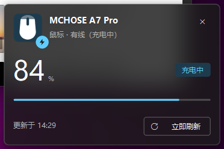
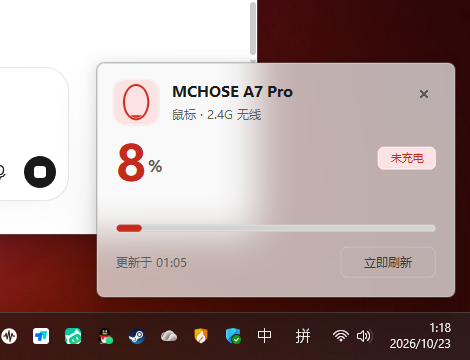
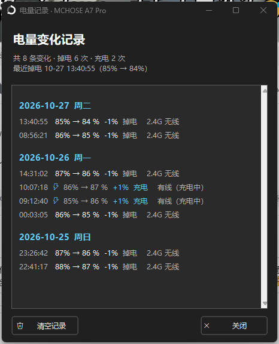
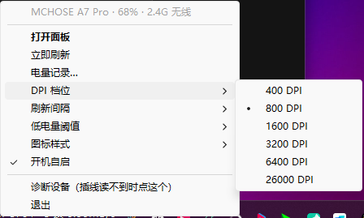

# MCHOSE 2.4G 电量托盘

<p align="center">
  
  
  
  
  
</p>

一个**不依赖厂商套件**的 Windows 托盘程序：在任务栏通知区域常驻显示迈从（MCHOSE）无线鼠标的电量，并支持直接切换 DPI 档位、记录每一次电量变化。所有通信都走官方固件的厂商自定义 HID 通道，无需安装 MCHOSE Center。

<p align="center">
  
  &nbsp;&nbsp;
  
</p>

## ✨ 功能

**电量显示**
- 托盘图标即电量：鼠标造型从底部涨满，深/浅色任务栏自动反色，低于阈值变红；另有电池 / 数字 / 圆环三种样式
- 左键弹出 Win11 Fluent 风格面板：毛玻璃卡片、DWM 圆角、大号电量、进度条、充电角标
- 悬停提示：设备名 · 电量 · 当前 DPI · 连接方式 · 更新时间

**DPI 切换**
- 右键菜单 6 档 DPI（默认 400 / 800 / 1600 / 3200 / 6400 / 26000），实时写回鼠标板载配置
- USB 与 2.4G 通道同时生效；写入后自动读回校验，档位表不一致会明确报错而不是假装成功
- 当前档位由连接方式决定：有线模式读 USB 通道，无线模式读 2.4G 通道

**电量记录**
- 每变化 1% 记录一条，时间精确到秒；插线充电时自动切换 10 秒快速轮询，拔线恢复原间隔
- 按天分组查看（带星期与统计），支持一键清空
- 三重防脏数据：垃圾包过滤（跳变 >10% 不采信）、记录基准沿用最后一次记录值（重启不掉档）、单条变化超过 5% 不落表

**其他**
- 低电量阈值提醒（10%~40% 可调）、开机自启、30 秒~10 分钟刷新间隔
- 读数异常自动保留上次电量，图标不闪灰；插线充电自动切换有线链路读取

<p align="center">
  
</p>

## 📦 获取

从 [Releases](https://github.com/Sanye223/mchose-2.4g-battery-tray/releases) 下载打包好的 exe，双击即用（数据存放在用户目录，不写注册表）。

或从源码构建：

```bat
git clone https://github.com/Sanye223/mchose-2.4g-battery-tray.git
cd mchose-2.4g-battery-tray

:: Python 3.13+（需要 tkinter）
python -m venv tkvenv
tkvenv\Scripts\python -m pip install pyinstaller hidapi pillow
tkvenv\Scripts\python -m PyInstaller --noconfirm --clean "2.4G电量托盘.spec"
```

> `fetch_wheels.py` 是辅助脚本：在无法直连 PyPI 的网络环境下离线拉取构建依赖。

## 🚀 使用

| 操作 | 功能 |
|---|---|
| **左键** 托盘图标 | 弹出 / 收起电量面板 |
| **右键 → DPI 档位** | 切换 DPI 档位（单选打点即当前档） |
| **右键 → 电量记录…** | 查看按天分组的电量变化记录 |
| **右键 → 刷新间隔** | 30 秒 / 1 / 2 / 5 / 10 分钟（插线充电时自动提为 10 秒） |
| **右键 → 低电量阈值** | 10% ~ 40%，低于阈值图标变红 |
| **右键 → 图标样式** | 鼠标 / 电池 / 数字 / 圆环 |
| **右键 → 开机自启** | 写入 HKCU Run 键（仅当前用户） |

命令行参数（排查用）：

```bat
2.4G电量托盘.exe --cli          :: 读一次电量打印后退出
2.4G电量托盘.exe --panel        :: 启动后直接打开面板（托盘图标被折叠时用）
2.4G电量托盘.exe --interval 10  :: 临时覆盖刷新间隔
```

## 🖱 DPI 档位适配

右键托盘图标 → **DPI 档位**，六档直接显示实际数值（400 ~ 26000），当前档位单选打点，点一下即写回鼠标板载配置：



托盘悬停提示同步显示当前生效的 DPI。档位判定跟随连接方式：有线模式读 USB 通道，无线模式读 2.4G 通道；X / Y 灵敏度设置不同时会显示成 `800/400`：


**切档流程**：读取板载配置（带命令字校验与全零回显过滤）→ 按 A7 Pro 写帧格式回写 → 睡 250ms 读回校验「档位生效 + 档位表完好」→ 刷新菜单与悬停提示。全过程约 1 秒，任何一步失败都会写日志并保留原配置，不会静默写坏档位表。

> A7 Pro 的写帧布局与读取帧**不同构**，直接回写读取帧会整表错位写坏——这也是本仓库与 FerrisPulse 实现的关键差异，详见 [docs/PROTOCOL.md](docs/PROTOCOL.md)。

## 🗂 数据位置

所有数据在 `%APPDATA%\MchoseBattery\`：

| 文件 | 内容 |
|---|---|
| `tray.json` | 设置（间隔 / 阈值 / 样式 / 自启） |
| `history.json` | 电量变化记录（最多 800 条，超出自动滚动） |
| `tray.log` | 运行日志（读数失败现场、切档结果都在这里） |

## 🔌 协议与逆向笔记

完整帧格式见 [`mchose_hid.py`](mchose_hid.py) 源码注释，详细的逆向过程与踩坑记录见 [`docs/PROTOCOL.md`](docs/PROTOCOL.md)。几条最重要的结论：

- 电量查询载荷是 `0x06`，**`F4 55` 是 profile 重载命令**——发出去鼠标会重载板载配置、DPI 直接被重置
- A7 Pro 的 **DPI 写帧与读帧不同构**：拿读取帧改字节回写会整表错位写坏（实测 X 变 26000/8193/16387）
- 2.4G 链路偶发垃圾包（实测 83% → 6% → 83%），显示和记录都必须做跳变过滤
- 插线充电时鼠标切到有线模式并更换 PID，读取要放宽候选设备条件

## ❓ FAQ

**Q：显示「设备未响应」？**
鼠标休眠或关机时固件不回包，属正常现象，动一下鼠标即可恢复；长时间无响应可看日志里「找到 N 个接口」判断链路状态。

**Q：插线充电后读不到电量？**
插线后鼠标会切到有线模式（换 PID），程序会自动扫描全部候选接口；若仍失败，把 `tray.log` 里「读取失败」的现场发 issue。

**Q：切换 DPI 后游戏里没变化？**
确认写回日志是「已切换到 XXX DPI」；部分游戏引擎会缓存鼠标设置，重进游戏即可。

## 🧪 兼容性

| 设备 | 状态 |
|---|---|
| MCHOSE A7 Pro（PAW3395，2.4G + 有线） | ✅ 完整验证（电量 / 记录 / DPI / 充电切换） |
| 其他 MCHOSE A7 系 / A5 系 | 协议同源，理论上可用，欢迎反馈 |

任何 VID 以 `5253` / `3837` 开头的接口都会被尝试，理论兼容更多迈从型号。

## 🙏 致谢

- [marsuyone/mchose-battery-tray](https://github.com/marsuyone/mchose-battery-tray) —— **本项目的起点**。A7 电量协议（`0x11` + `0x06`、65 字节 XOR 帧、65 字节必须补满否则 err 87）即来自它对迈从官方网页驱动（WebHID）的逆向，本项目在其电量协议之上扩展出了面板、记录与 DPI 切换
- [FerrisPulse](https://github.com/Ferris-echo/FerrisPulse) —— 配置通道框架与 A5 V2 协议参考
- [hidapi](https://github.com/libusb/hidapi) · [pystray](https://github.com/moses-palmer/pystray) · [Pillow](https://github.com/python-pillow/Pillow)

## License

[MIT](LICENSE) © 2026
